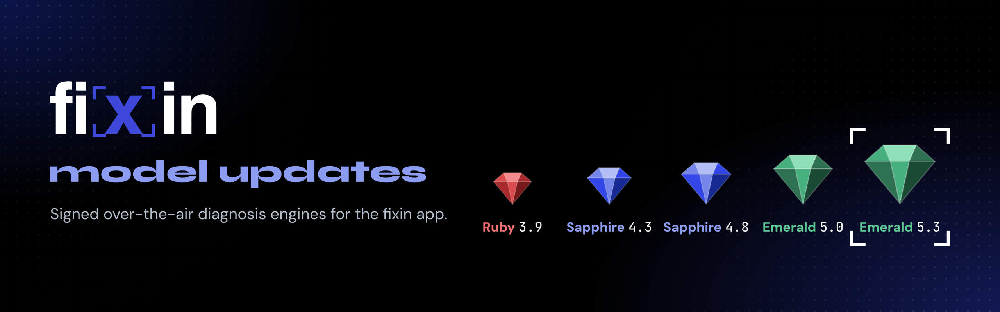
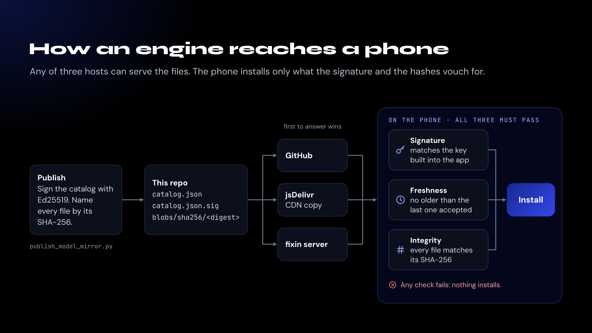
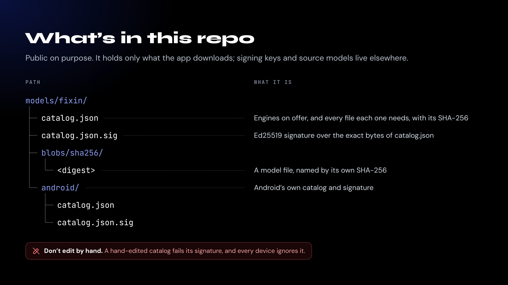

<p align="center">
  
</p>

<p align="center">
  <a href="models/fixin/catalog.json"></a>
  <a href="models/fixin/android/catalog.json"></a>
  <a href="#verify-a-catalog-yourself"></a>
  <a href="#how-an-engine-reaches-a-phone"></a>
</p>

<p align="center">
  <a href="https://apps.apple.com/us/app/fixin/id6755448308"><b>fixin for iPhone</b></a>
  &nbsp;·&nbsp;
  <a href="https://play.google.com/store/apps/details?id=com.fixin.android"><b>fixin for Android</b></a>
  &nbsp;·&nbsp;
  <a href="https://amsolutions-sea.com/fixin"><b>amsolutions-sea.com/fixin</b></a>
</p>

---

fixin diagnoses car, home and boat problems from a photo, using machine-learning models that run on the phone. Each set of models is an **engine**, named for a gem and a version: the gem marks the generation and the number is the release.

This repo delivers new engines to phones between app releases. It holds only what the app downloads: a signed catalog for each platform and the model files it lists. Nothing here runs on its own, and you don't need anything from it to use fixin.

> [!NOTE]
> **The catalogs are empty for now, on purpose.** Every current engine ships inside the app, so the first engine published here will be a retrained one. Support for this mirror is rolling out in app updates; earlier builds get updates from the fixin server only.

## How an engine reaches a phone

<p align="center">
  
</p>

The app asks GitHub first, then the jsDelivr copy of this repo, then the fixin server, for the catalog and for each file. A source that's down, or serves a file that fails its check, is skipped for the next one. Any of the three can serve the files, because the phone trusts only what the signature and the hashes vouch for:

1. **Signed.** The app reads a catalog only when `catalog.json.sig` is a valid Ed25519 signature over its exact bytes, made with the private half of a key built into the app. That key never leaves the publisher's machine, so an edited catalog fails everywhere.
2. **Never older.** Each catalog records when it was signed, and the app refuses one older than the last it accepted, so an out-of-date copy can't roll a phone back to an older engine.
3. **Every file checked.** The catalog lists the SHA-256 of every file it names, and each file is stored under that digest. An engine installs only when every one of its files passes, all or nothing.

## What's in this repo

<p align="center">
  
</p>

iOS engines are Core ML and Android engines are TensorFlow Lite. Each platform has its own catalog, so a phone downloads only what it can run, and a file that's identical on both is stored once. Browse the [iOS catalog](models/fixin/catalog.json) or the [Android catalog](models/fixin/android/catalog.json).

## Verify a catalog yourself

The app does this on every check, so you never need to. If you'd like to, you'll need OpenSSL 3 or later. The LibreSSL that ships with macOS can't check Ed25519 signatures, so use Homebrew's `openssl`.

```bash
base=https://raw.githubusercontent.com/MatthewMcLellan/fixin-model-updates/main/models/fixin
curl -s "$base/catalog.json" -o catalog.json
curl -s "$base/catalog.json.sig" | base64 -d > catalog.sig

cat > fixin-models.pub <<'EOF'
-----BEGIN PUBLIC KEY-----
MCowBQYDK2VwAyEAfeQ3UpbYFVKNyD92RtgvEuIrWJCGHONsMhRD5zh/nBQ=
-----END PUBLIC KEY-----
EOF

openssl pkeyutl -verify -pubin -inkey fixin-models.pub -rawin -in catalog.json -sigfile catalog.sig
```

It prints `Signature Verified Successfully`. For the Android catalog, add `/android` to the end of `base`. This is the public key compiled into the app. If it ever changes, an app update will ship the new key before anything is published with it.

<details>
<summary><b>For maintainers</b></summary>
<br>

**Don't edit anything under `models/` by hand.** A hand-edited catalog fails its signature, and every phone ignores it. Publish with `Tools/publish_model_mirror.py` in the iOS app repo or `tools/publish_model_mirror.py` in the Android app repo. Each one signs the catalog and pushes it with every file it names in **one commit**, so GitHub never serves a catalog whose files aren't there yet. Then it asks jsDelivr to refresh.

The publishers only write under `models/`, so this README, `LICENSE` and `.github/` are safe to edit. `.gitattributes` stops git from changing line endings, because every file here has to be served byte for byte.

</details>

## Security

If you find a problem with a catalog, a signature or a file here, email [help@fixin-support.com](mailto:help@fixin-support.com) rather than opening a public issue.

---

<sub>© 2026 AM Solutions, Seattle, WA. All rights reserved. The models and catalogs here are proprietary and published only for the fixin app to download; see <a href="LICENSE">LICENSE</a>.</sub>
