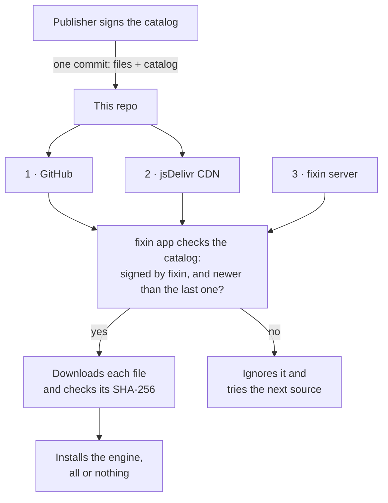

<p align="center">
  <picture>
    <source media="(prefers-color-scheme: dark)" srcset=".github/assets/fixin-wordmark-white.svg">
    
  </picture>
</p>

<h3 align="center">Model updates</h3>

<p align="center">
  Signed, over-the-air diagnosis engine updates for the fixin app on iOS and Android.
</p>

<p align="center">
  <a href="models/fixin/catalog.json"></a>
  <a href="models/fixin/android/catalog.json"></a>
  <a href="#verify-a-catalog-yourself"></a>
</p>

---

## What this is

fixin diagnoses car, home and boat problems from a photo, using machine-learning models that run on the phone. Each set of models is an *engine*, named for a gem and a version, like Sapphire 4.8 or Emerald 5.0.

This repo is how new engines reach phones between app releases. The app checks here, and downloads an engine when one is on offer for your plan and app version. Nothing in here runs on its own, and you don't need anything from it to use fixin.

**Looking for the app?** Get [fixin for iPhone](https://apps.apple.com/us/app/fixin/id6755448308) or [fixin for Android](https://play.google.com/store/apps/details?id=com.fixin.android), or read more at [amsolutions-sea.com/fixin](https://amsolutions-sea.com/fixin).

## How an update reaches a phone



The app tries the three sources in order, for the catalog and for each file. A source that's down or serves a bad copy is skipped. Three checks make it safe to take files from any of them:

1. **Signed.** The app reads a catalog only when `catalog.json.sig` is a valid Ed25519 signature over its exact bytes, from a key built into the app. The private key never leaves the publisher's machine, so an edited catalog fails everywhere.
2. **Never older.** Each catalog records when it was signed, and the app refuses one older than the last it accepted, so an out-of-date copy can't roll a phone back.
3. **Every file checked.** The catalog lists the SHA-256 of every file it names, and each file is stored under that digest. The app checks each download, and installs an engine only when every one of its files passes.

## What's in here

| Path | What it is |
| --- | --- |
| [`models/fixin/catalog.json`](models/fixin/catalog.json) | iOS catalog: the engines on offer, who can get them, and every file each one needs |
| [`models/fixin/android/catalog.json`](models/fixin/android/catalog.json) | Android catalog, in the same format |
| `catalog.json.sig` next to each catalog | Its Ed25519 signature, base64-encoded |
| `models/fixin/blobs/sha256/<digest>` | The model files, each named by its SHA-256 and shared by both platforms |

iOS engines are Core ML and Android engines are TensorFlow Lite. They have separate catalogs so each phone downloads only what it can run, but a file that's identical on both is stored once.

## Verify a catalog yourself

You don't need to, since the app does this on every check. If you want to, you'll need OpenSSL 3 or later. The LibreSSL that ships with macOS can't check Ed25519 signatures, so use Homebrew's `openssl`.

```bash
base=https://raw.githubusercontent.com/MatthewMcLellan/fixin-model-updates/main/models/fixin
curl -s "$base/catalog.json" -o catalog.json
curl -s "$base/catalog.json.sig" | base64 -d > catalog.sig

cat > fixin-models.pub <<'EOF'
-----BEGIN PUBLIC KEY-----
MCowBQYDK2VwAyEAfeQ3UpbYFVKNyD92RtgvEuIrWJCGHONsMhRD5zh/nBQ=
-----END PUBLIC KEY-----
EOF

openssl pkeyutl -verify -pubin -inkey fixin-models.pub -rawin -in catalog.json -sigfile catalog.sig
```

It prints `Signature Verified Successfully`. For the Android catalog, add `/android` to the end of `base`. The key is the one compiled into both apps. If it ever changes, a new app version will ship with the new key before anything is published with it.

<details>
<summary><b>For maintainers</b></summary>
<br>

**Don't edit anything under `models/` by hand.** A hand-edited catalog fails its signature, and every phone ignores it. Publish with `Tools/publish_model_mirror.py` in the iOS app repo or `tools/publish_model_mirror.py` in the Android app repo. Each one signs the catalog and pushes it with every file it names in **one commit**, so GitHub never serves a catalog whose files aren't there yet. Then it asks jsDelivr to refresh.

The publishers only write under `models/`, so this README, `LICENSE` and `.github/` are safe to edit. `.gitattributes` stops git from changing line endings, because every file here has to be served byte for byte.

</details>

## Security

If you find a problem with a catalog, a signature or a file here, email [help@fixin-support.com](mailto:help@fixin-support.com) rather than opening a public issue.

---

<sub>© 2026 AM Solutions, Seattle, WA. All rights reserved. The models and catalogs here are proprietary and published only for the fixin app to download; see <a href="LICENSE">LICENSE</a>.</sub>
